# EduSphere — System Design and Checking Notes

## 1. Project concept and major functions

EduSphere is an adaptive programming-learning platform. A student takes a placement assessment; the system records skill mastery and orders lessons to address the largest gaps first. Students then study lessons, run code against exercises, submit work for anonymous peer review, track progress, earn badges, and receive publicly verifiable certificates. Instructors manage courses and assignments; administrators manage users.

| Role | Main functions |
|---|---|
| Visitor | View the landing page, register/sign in, and verify a certificate. |
| Student | Take placement, follow a personalized path, study courses/lessons, run exercises, submit assignments, review peers, and see progress, badges, notifications, sessions, and billing. |
| Instructor | View classroom analytics, build courses, author coding assignments, and manage sessions. |
| Administrator | View and manage user accounts. |

## 2. Site map

```text
EduSphere
├── Public
│   ├── /                         Landing page
│   ├── /login                    Sign in
│   ├── /register                 Create account
│   ├── /verify-email             Enter/resend email code
│   ├── /verify                   Find/verify a credential
│   └── /verify/[code]            Public certificate result
├── Student (signed in)
│   ├── /dashboard                XP, streak, skill mastery, next lessons
│   ├── /profile                  Profile details
│   ├── /assessment               Placement assessment
│   ├── /path                     Personalized learning path
│   ├── /lessons/[id]             Lesson content and completion
│   ├── /courses                  Browse courses
│   ├── /courses/[id]             Course overview/enrollment
│   ├── /assignments              Published coding assignments and attempts
│   ├── /playground               Coding exercises and free runs
│   ├── /review                   Anonymous peer-review queue
│   ├── /feedback                 Reviews received
│   ├── /progress                 Learning and activity analytics
│   ├── /badges                   Earned credentials
│   ├── /leaderboard              Student ranking
│   ├── /sessions                 Live learning sessions
│   └── /billing                  Plan/checkout
├── Instructor
│   ├── /instructor               Classroom analytics
│   ├── /instructor/courses       Course/module/lesson builder
│   ├── /instructor/assignments   Assignment authoring and results
│   ├── /playground               Exercise runner
│   ├── /sessions                 Live learning sessions
│   └── /leaderboard              Student ranking
├── Administrator
│   ├── /admin                    User management
│   └── /sessions                 Live learning sessions
└── JSON API
    └── LavaLust API: /api/v1/* (partial implementation; see backend/app/config/routes.php)
```

The React application shell provides role-based navigation, notifications, profile access, theme switching, and sign-out. The Vite development server proxies API calls to the PHP backend. Some course and coding-assignment screens still require API endpoints that have not yet been implemented in PHP.

## 3. Initial interface wireframes

These are structural wireframes for explaining the implemented interface, not pixel-perfect mockups.

### Landing

```text
┌───────────────────────────────────────────────────────────────────────────┐
│ EduSphere       Playground   Your Path   Progress   Stories     /verify  │
│                                                            [Start free]   │
├──────────────────────────────────┬────────────────────────────────────────┤
│ ADAPTIVE LEARNING · PLACEMENT     │  orbit paths, skill tags, and a         │
│                                   │  friendly planet illustration           │
│ Learning that                     │  XP / streak callouts                    │
│ orbits around                     │                                         │
│ you.                              │                                         │
│ Ten questions; a path sequenced   │                                         │
│ around the student's skill gaps. │                                         │
│ [Take the placement] [Playground]│                                         │
│ ┌─ Quick placement check ───────┐ │                                         │
│ │ Example question + choices    │ │                                         │
│ └───────────────────────────────┘ │                                         │
├──────────────────────────────────┴────────────────────────────────────────┤
│ How it works → learning modules → pricing → demo access → footer           │
└───────────────────────────────────────────────────────────────────────────┘
```

### Student dashboard

```text
┌──────────────┬────────────────────────────────────────────────────────────┐
│ EduSphere    │ Page title/breadcrumb                 Theme  Bell  Profile │
│ Dashboard    ├────────────────────────────────────────────────────────────┤
│ Profile      │ Welcome + placement/path status                            │
│ Placement    │ ┌─────────┐ ┌────────┐ ┌────────────┐ ┌────────────────┐   │
│ My Path      │ │ XP/level│ │ Streak │ │ Path       │ │ Skill mastery  │   │
│ Playground   │ └─────────┘ └────────┘ └────────────┘ └────────────────┘   │
│ Courses      │ ┌────────────────────────┐ ┌─────────────────────────────┐ │
│ Peer Review  │ │ Next lessons            │ │ Skill constellation/radar   │ │
│ Progress     │ └────────────────────────┘ └─────────────────────────────┘ │
│ Credentials  │ ┌────────────────────────┐ ┌─────────────────────────────┐ │
│ ...          │ │ Biggest skill gaps     │ │ Weekly learning throughput │ │
│ Sign out     │ └────────────────────────┘ └─────────────────────────────┘ │
└──────────────┴────────────────────────────────────────────────────────────┘
```

### Placement, path, and lesson flow

```text
Placement (/assessment)        Learning path (/path)        Lesson (/lessons/[id])
┌───────────────────────┐      ┌───────────────────────┐    ┌─────────────────────┐
│ Question 3 of 10      │      │ Skill constellation   │    │ Course / module     │
│ [Prompt]              │      │ ○──●──○──🔒──🔒      │    │ Lesson title        │
│ ( ) Answer A          │ ───▶ │ Current lesson first  │ ─▶ │ Lesson content      │
│ ( ) Answer B          │      │ Completed / locked    │    │ Skills + time       │
│ [Previous] [Continue] │      │ [Open current lesson] │    │ [Mark complete]     │
└───────────────────────┘      └───────────────────────┘    └─────────────────────┘
```

### Playground and peer review

```text
Playground (/playground)                      Peer review (/review)
┌──────────────────────────────────────┐      ┌────────────────────────────────┐
│ Exercise list │ Prompt / test cases  │      │ Anonymous submission alias      │
│               ├──────────────────────│      │ Student code / assignment       │
│               │ Monaco code editor   │      │ Rubric criteria + score sliders │
│               │                      │      │ Feedback text                   │
│               │ [Run] [Submit]       │      │ [Submit review]                 │
│               ├──────────────────────│      └────────────────────────────────┘
│               │ Results / stdout     │
└──────────────────────────────────────┘
```

## 4. Database design

The database is MySQL/InnoDB with `utf8mb4`. Tables use UUID-like `CHAR(36)` primary keys unless a junction table uses a composite key. Foreign keys represent ownership and content relationships; cascading deletion is used for dependent records where appropriate. Unique indexes enforce natural uniqueness and prevent duplicate enrollments, progress records, badges, and certificates.

The ERD below shows the main entity relationships. Field inventories follow and use `PK`, `FK`, and `UK` to identify primary, foreign, and unique keys. The executable source of truth is `backend/database/schema.sql` plus the migrations listed after the inventory.

```mermaid
erDiagram
  INSTITUTIONS ||--o{ USERS : includes
  USERS ||--o{ REFRESH_TOKENS : owns
  USERS ||--o| EMAIL_VERIFICATIONS : verifies
  USERS ||--o{ COURSES : teaches
  COURSES ||--o{ MODULES : contains
  MODULES ||--o{ LESSONS : contains
  COURSES ||--o{ COURSE_SKILLS : maps
  SKILLS ||--o{ COURSE_SKILLS : tagged
  LESSONS ||--o{ LESSON_SKILLS : maps
  SKILLS ||--o{ LESSON_SKILLS : tagged
  COURSES ||--o{ ASSESSMENTS : has
  ASSESSMENTS ||--o{ ASSESSMENT_QUESTIONS : asks
  SKILLS ||--o{ ASSESSMENT_QUESTIONS : measures
  ASSESSMENTS ||--o{ ASSESSMENT_ATTEMPTS : receives
  USERS ||--o{ ASSESSMENT_ATTEMPTS : takes
  ASSESSMENT_ATTEMPTS ||--o{ ATTEMPT_ANSWERS : records
  ASSESSMENT_QUESTIONS ||--o{ ATTEMPT_ANSWERS : answered
  USERS ||--o{ STUDENT_SKILL_SCORES : earns
  SKILLS ||--o{ STUDENT_SKILL_SCORES : measured
  USERS ||--o{ LEARNING_PATHS : follows
  COURSES ||--o{ LEARNING_PATHS : guides
  LEARNING_PATHS ||--o{ LEARNING_PATH_ITEMS : orders
  LESSONS ||--o{ LEARNING_PATH_ITEMS : scheduled
  COURSES ||--o{ CODING_EXERCISES : offers
  SKILLS o|--o{ CODING_EXERCISES : targets
  CODING_EXERCISES ||--o{ TEST_CASES : tests
  USERS ||--o{ SUBMISSIONS : creates
  CODING_EXERCISES o|--o{ SUBMISSIONS : exercises
  USERS ||--o{ EXECUTION_RESULTS : runs
  SUBMISSIONS o|--o{ EXECUTION_RESULTS : produces
  CODING_ASSIGNMENTS ||--o{ CODING_ASSIGNMENT_ATTEMPTS : receives
  USERS ||--o{ CODING_ASSIGNMENT_ATTEMPTS : attempts
  COURSES ||--o{ CODING_ASSIGNMENTS : assigns
  CODING_EXERCISES ||--o{ CODING_ASSIGNMENTS : uses
  SUBMISSIONS ||--o{ PEER_ASSIGNMENTS : routed
  USERS ||--o{ PEER_ASSIGNMENTS : reviews
  PEER_ASSIGNMENTS ||--o| PEER_REVIEWS : completed_as
  PEER_REVIEWS ||--o{ REVIEW_SCORES : scores
  RUBRIC_CRITERIA ||--o{ REVIEW_SCORES : criterion
  USERS ||--o{ PROGRESS_RECORDS : completes
  LESSONS ||--o{ PROGRESS_RECORDS : tracked
  USERS ||--o| STREAKS : has
  USERS ||--o{ USER_BADGES : earns
  BADGES ||--o{ USER_BADGES : awarded
  USERS ||--o{ CERTIFICATES : receives
  COURSES ||--o{ CERTIFICATES : certifies
  COURSES ||--o{ COURSE_ENROLLMENTS : enrollments
  USERS ||--o{ COURSE_ENROLLMENTS : enrolls
  COURSES ||--o{ COURSE_MATERIALS : stores
  MODULES ||--o{ COURSE_MATERIALS : contains
  COURSES ||--o| FINAL_ASSESSMENTS : final
  FINAL_ASSESSMENTS ||--o{ FINAL_ASSESSMENT_QUESTIONS : asks
  FINAL_ASSESSMENTS ||--o{ FINAL_ASSESSMENT_ATTEMPTS : receives
  USERS ||--o{ FINAL_ASSESSMENT_ATTEMPTS : attempts
  USERS ||--o{ NOTIFICATIONS : receives
  USERS ||--o{ LIVE_SESSIONS : hosts
  COURSES ||--o{ LIVE_SESSIONS : schedules
```



### Table and field inventory

The columns below are grouped by purpose. `id` is the primary key where shown. A junction table may use a composite PK instead. Fields not marked `FK` are data columns; timestamp/default behavior is defined in the SQL schema.

| Table | Primary key | Foreign keys | Other fields |
|---|---|---|---|
| `institutions` | `id` | — | `name`, `domain`, `created_at` |
| `users` | `id` | `institution_id` → institutions | `name`, `email` (UK), `password_hash`, `role`, `xp`, `level`, `active`, `email_verified`, `avatar`, `bio`, `created_at`, `updated_at` |
| `email_verifications` | `id` | `user_id` → users (UK) | `code_hash`, `expires_at`, `created_at` |
| `refresh_tokens` | `id` | `user_id` → users | `token_hash`, `expires_at`, `revoked_at`, `created_at` |
| `courses` | `id` | `instructor_id` → users | `title`, `slug` (UK), `description`, `level`, `accent`, `published`, `created_at` |
| `modules` | `id` | `course_id` → courses | `title`, `position` |
| `lessons` | `id` | `module_id` → modules | `title`, `content`, `estimated_minutes`, `position`, `created_at` |
| `skills` | `id` | — | `name`, `slug` (UK), `category` |
| `course_skills` | (`course_id`, `skill_id`) | `course_id` → courses; `skill_id` → skills | — |
| `lesson_skills` | (`lesson_id`, `skill_id`) | `lesson_id` → lessons; `skill_id` → skills | — |
| `assessments` | `id` | `course_id` → courses | `title`, `kind`, `created_at` |
| `assessment_questions` | `id` | `assessment_id` → assessments; `skill_id` → skills | `type`, `prompt`, `options`, `answer`, `points`, `position` |
| `assessment_attempts` | `id` | `assessment_id` → assessments; `user_id` → users | `status`, `score`, `started_at`, `submitted_at` |
| `attempt_answers` | `id` | `attempt_id` → assessment_attempts; `question_id` → assessment_questions | `response`, `is_correct`, `points_awarded` |
| `student_skill_scores` | `id` | `user_id` → users; `skill_id` → skills | `source`, `score`, `measured_at` |
| `learning_paths` | `id` | `user_id` → users; `course_id` → courses | `status`, `velocity`, `rationale`, `generated_at`, `completed_at` |
| `learning_path_items` | `id` | `path_id` → learning_paths; `lesson_id` → lessons | `position`, `status`, `completed_at` |
| `coding_exercises` | `id` | `course_id` → courses; nullable `skill_id` → skills | `title`, `prompt`, `language`, `starter_code`, `time_limit_sec`, `created_at` |
| `test_cases` | `id` | `exercise_id` → coding_exercises | `input`, `expected`, `hidden`, `position` |
| `submissions` | `id` | `user_id` → users; nullable `exercise_id` → coding_exercises | `kind`, nullable `title`, `code`, `language`, `status`, `created_at` |
| `execution_results` | `id` | `user_id` → users; nullable `submission_id` → submissions; nullable `exercise_id` → coding_exercises | `stdout`, `stderr`, `runtime_ms`, `passed_count`, `total_count`, `results`, `created_at` |
| `coding_assignments` | `id` | `course_id` → courses; `exercise_id` → coding_exercises; `instructor_id` → users | `title`, `instructions`, nullable `due_at`, `published`, `created_at`, `updated_at` |
| `coding_assignment_attempts` | `id` | `assignment_id` → coding_assignments; `user_id` → users; nullable `execution_result_id` → execution_results | `code`, `passed_count`, `total_count`, `score`, `is_late`, `submitted_at` |
| `rubrics` | `id` | `course_id` → courses | `title` |
| `rubric_criteria` | `id` | `rubric_id` → rubrics | `label`, `description`, `max_points`, `position` |
| `peer_assignments` | `id` | `submission_id` → submissions; `reviewer_id` → users | `status`, `assigned_at`, nullable `completed_at`; unique (`submission_id`, `reviewer_id`) |
| `peer_reviews` | `id` | `assignment_id` → peer_assignments (UK); `submission_id` → submissions; `reviewer_id` → users | `overall_comment`, `created_at` |
| `review_scores` | `id` | `review_id` → peer_reviews; `criterion_id` → rubric_criteria | `score` |
| `progress_records` | `id` | `user_id` → users; `lesson_id` → lessons | `time_spent_sec`, `completed_at`; unique (`user_id`, `lesson_id`) |
| `streaks` | `id` | `user_id` → users (UK) | `current`, `longest`, nullable `last_activity_date` |
| `badges` | `id` | — | `code` (UK), `name`, `description`, `icon`, `accent`, `xp_reward` |
| `user_badges` | `id` | `user_id` → users; `badge_id` → badges | `awarded_at`; unique (`user_id`, `badge_id`) |
| `certificates` | `id` | `user_id` → users; `course_id` → courses | `code` (UK), `issued_at`; migration 003 adds unique (`user_id`, `course_id`) |
| `subscriptions` | `id` | `user_id` → users | `plan`, `status`, nullable `provider_reference`, nullable `expires_at` |
| `payments` | `id` | `user_id` → users | `amount_cents`, `currency`, `status`, `provider`, nullable `provider_reference`, `plan` |
| `payouts` | `id` | `instructor_id` → users | `amount_cents`, `status`, `created_at` |
| `live_sessions` | `id` | `course_id` → courses; `host_id` → users | `title`, `starts_at`, `duration_min`, `room_code`, `join_url`, `created_at` |
| `files` | `id` | `user_id` → users | `key`, `bytes`, nullable `content_type`, `created_at` |
| `notifications` | `id` | `user_id` → users | `type`, `title`, `body`, nullable `read_at`, `created_at` |
| `audit_logs` | `id` | nullable `user_id` → users | `action`, nullable `meta`, `created_at` |
| `course_enrollments` | `id` | `course_id` → courses; `user_id` → users | `enrolled_at`; unique (`course_id`, `user_id`) |
| `course_materials` | `id` | `course_id` → courses; `module_id` → modules; `uploaded_by` → users | `name`, `storage_key` (UK), `content_type`, `bytes`, `created_at` |
| `final_assessments` | `id` | `course_id` → courses (UK) | `title`, `pass_score`, `created_at`, `updated_at` |
| `final_assessment_questions` | `id` | `assessment_id` → final_assessments | `prompt`, `options`, `correct_option`, `points`, `position` |
| `final_assessment_attempts` | `id` | `assessment_id` → final_assessments; `user_id` → users | `score`, `passed`, `submitted_at` |

**Schema files:** `backend/database/schema.sql` is the baseline schema. Versioned migrations are `backend/database/migrations/002_coding_classroom.sql`, `003_course_certificates.sql`, and `004_profile_email_verification.sql`. The baseline schema contains `DROP TABLE` statements and is only for a new, empty database; never re-import it into a database containing data. Some migrations overlap the current baseline for older database versions, so inspect the existing schema and apply only missing changes—these migrations are not safe to re-run blindly.

## 5–7. Framework, routes, and local run

- **Frontend:** React 19, Vite, and React Router in `frontend/`; routes are wired in `frontend/src/main.tsx` and screen components are under `frontend/src/app/`. Start from `frontend/` with `npm install` and `npm run dev`.
- **Backend:** LavaLust 4.7.0 in `backend/`; route definitions are in `backend/app/config/routes.php`, controllers in `backend/app/controllers/`, and database models in `backend/app/models/`. Database settings are read from `backend/.env` by the LavaLust bootstrap. The required PDO MySQL extension is installed in the checked PHP CLI.
- **Database access:** `backend/app/config/database.php` reads `DB_HOST`, `DB_PORT`, `DB_USER`, `DB_PASSWORD`, and `DB_NAME`. Controllers call models; models use LavaLust's database connection and prepared queries. For example, `Content_model::publishedCourses()` queries course rows and lesson counts from MySQL, and `LearningController::courses()` returns those rows.
- **API routes:** routes cover authentication, course/lesson reads, placement and learning paths, coding exercises, submissions and peer review, analytics, credentials, sessions, notifications, payments, uploads, and admin users. The health route is `GET /api/v1/health`.
- **Views:** the LavaLust service is JSON-only. The React SPA is served by Vite and proxies `/api/*` to `http://127.0.0.1:8080`; `VITE_API_BASE_URL` can point to a separately hosted PHP API. The PHP API is partial, so unavailable course and coding-assignment features should not be presented as working.
- **Database records:** `backend/database/seed.sql` includes demo users, courses, skills, modules, lessons, and related sample records. Course and lesson endpoints query the database; they are not intended to be hardcoded page content.

### Checking checklist: current evidence and remaining work

| Requirement | Current evidence | Status / action before demonstration |
|---|---|---|
| Concept, functions, and sitemap | Sections 1–2; working pages in `frontend/src/app/` | Ready to present. |
| Initial interface designs | Section 3 and implemented React screens | Ready to present; open the landing page and student dashboard. |
| Database design | Section 4, ERD, field/key inventory, SQL schema | Ready to present. |
| LavaLust project, controllers, routes, and models | `backend/` framework; `app/config/routes.php`; controllers/models listed above | PHP and Composer are present; PHP syntax and Composer checks pass. Docker is not installed in this workstation. |
| Local application run | React production build, TypeScript, and lint checks pass | `npm run dev` starts React at `http://localhost:5173` and PHP at `http://localhost:8080`. |
| Successful PHP database connection | `GET /api/v1/health` returns `db: up` | Verified locally. |
| Dynamic database records | Seed SQL plus model queries such as `publishedCourses()` | Database connection is healthy; course catalog requires an authenticated request. |
| PHP backend connected to views | React uses the PHP API through Vite's `/api` proxy | Core implemented routes, including Google sign-in, are connected; course authoring/enrollment/materials/final assessments, and coding-assignment authoring/attempts remain unavailable. |

## Suggested demonstration order

1. Show the landing page and walk through the sitemap and wireframes in this document.
2. Show the ERD and open `backend/database/schema.sql` plus the additive migrations. Explain that the baseline SQL is destructive and should only be used for an empty database.
3. Start the application from `frontend/` with `npm run dev`; sign in with a seeded demo account and show supported database-backed views.
4. Call `http://localhost:5173/api/v1/health` and show `db: up`.
5. Show `backend/app/config/routes.php`, one controller, and its corresponding model query. Demonstrate a GET endpoint returning actual rows.
